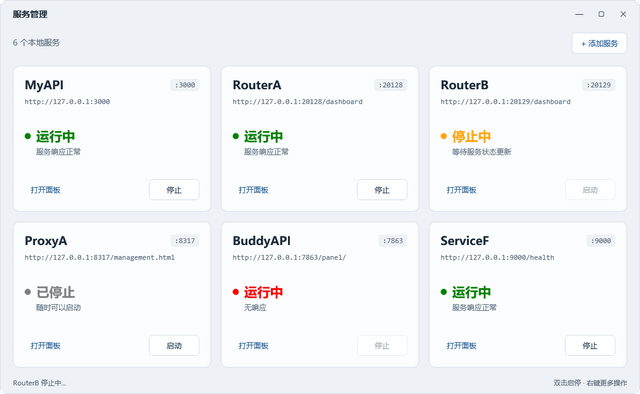
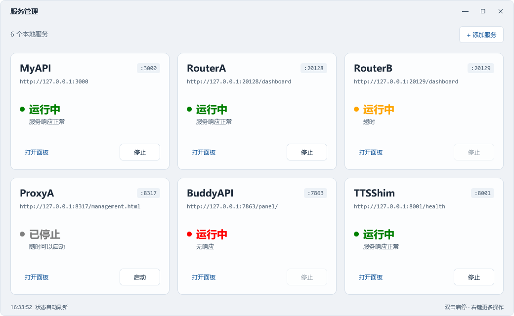

# nssm-service-manager

[](https://github.com/xvyimu/nssm-service-manager/actions/workflows/test.yml)

本地 Windows 服务的统一管理 GUI——PowerShell 7 + WPF，卡片式启停/健康探测/日志查看，零外部 npm 依赖。管 NSSM 服务（sc.exe / nssm.exe）。




## 为什么用它

NSSM 本身是命令行工具。服务一多，日常启停、查状态、看日志全靠背命令——这个工具把你的 NSSM 服务收敛成一个窗口：

- **一眼看全**——每张卡显示服务名、端口、健康圆点（绿=正常 / 橙=响应慢 / 红=无响应），六个服务一屏扫完，不用逐个 `sc query` 或开任务管理器
- **点两下启停**——双击卡片切换启停，右键管重启/日志/删除；8 秒冷却 + 健康门闩挡住「刚停下来又点启动」这类误操作
- **配置是清单不是代码**——`services.json` 一份 JSON 列出所有服务，换机器复制即用；CLI 也有增删入口（`-Add`），脚本和 agent 可以直接调用
- **健康探测不靠猜**——端口 TCP + HTTP 两档并行探测：服务在但响应慢标「超时」，端口没监听标「无响应」
- **安全默认**——删除服务要输入完整名称确认；新增服务时环境变量会做敏感键检测（`*_API_KEY` / `*_TOKEN` / `*SECRET` / `*PASSWORD` 命中会提示明文进注册表的风险）

如果你的机器上跑着三五个 NSSM 服务，它值得替代「任务管理器 + 手敲命令」的组合。

## 快速开始

```powershell
# 1. 装依赖（NSSM 用 scoop，或自行放置后设 NSSM_PATH）
scoop install nssm

# 2. 复制示例配置（config.json 可选，不复制就用内嵌默认值）
Copy-Item services.example.json services.json
Copy-Item config.example.json config.json

# 3. 跑回归测试（不需要管理员）
pwsh -NoProfile -File tests/run-all.ps1

# 4. 启动 GUI（会弹 UAC，NSSM/sc.exe 需要管理员）
pwsh -NoProfile -File service-manager-gui.ps1
```

双击入口是 `launch.vbs`（wscript 无控制台，不闪黑窗）。

这是一个通用的本地 Windows 服务管理工具——不绑定任何特定服务。把你要管的本地服务写进 `services.json`，GUI 就管它们的启停和健康探测。要不要托管哪个服务、几个服务，完全由你定。

条目形状：

- **NSSM 服务**：走 `sc.exe` 状态查询 + `nssm.exe` 注册/删除，TCP + HTTP 双档健康探测，端口徽章显示 `:端口号`。

## 文件

| 文件 | 作用 |
|------|------|
| `launch.vbs` | 启动器（双击入口）：wscript 无控制台 → ShellExecute runas pwsh → 管理员 GUI，零黑窗 |
| `service-manager-gui.ps1` | 主入口：CLI 分支 + 提权 + 模块加载 + 窗口启动 |
| `lib/theme.ps1` | 系统字体、主题色、按钮样式、Mica P/Invoke |
| `lib/util.ps1` | 配置持久化（`Load-Svc` / `Save-Svc`）、状态栏与租约、日志轮转、安全检查、命令入队 |
| `lib/poll.ps1` | 后台 runspace 探测脚本块（Get-Service 批量 + TcpClient + HttpClient 三档健康）+ 命令执行 |
| `lib/svc-common.ps1` | UI 线程与后台 runspace 共用的服务操作原语（`Wait-Stopped` / `Invoke-ServiceRemove` / 退出码与状态中文映射）——poll.ps1 构造 runspace 时前置其文本 |
| `lib/svc-input.ps1` | 纯函数族：输入校验、env 解析、敏感键名检测、NSSM set 参数组装（可单独点源，不加载 WPF/config） |
| `lib/nssm.ps1` | NSSM 注册/删除：`nssm-set` / `Install-NssmService` / `Remove-NssmService` |
| `lib/add-svc.ps1` | CLI 添加服务入口（`Add-SvcFromCli`，agent 友好，不弹 GUI） |
| `lib/dialogs.ps1` | GUI 对话框：`Show-Add` / `New-AddDialog`（注册；后者只搭控件，留给无头测试）+ `Show-Remove`（输入全名确认才点亮删除） |
| `lib/logview.ps1` | 日志窗口：`Get-LogFiles` / `Show-Log` |
| `lib/config.ps1` | 可调常量集中收口（每页卡片数 / 探测超时 / 日志轮转 / 双击冷却 / 托盘开关），默认值内嵌，`config.json` 覆盖 |
| `lib/tray.ps1` | 可选托盘图标（`TrayEnabled` 打开才加载 WinForms）+ 关闭/最小化策略纯函数 |
| `lib/card.ps1` | 卡片构建 + 双击防抖（8s 冷却 + 健康门闩）+ 过渡态保护 + 右键菜单 |
| `lib/xaml.ps1` | 主窗口外壳（自定义标题栏 + 最大化/双击标题栏 + 工具栏 + 分页 + 状态栏） |
| `assets/icon.ico` | 自绘齿轮图标（窗口 + 任务栏） |
| `services.example.json` | 服务清单示例（复制为 `services.json` 使用；后者已 git 忽略） |
| `config.example.json` | 可调常量示例（复制为 `config.json` 使用；后者已 git 忽略） |
| `scripts/set-service-params-acl.ps1` | 收紧 NSSM 服务 `Parameters` 注册表键 ACL（移除 `BUILTIN\Users` 读权限，见下） |
| `tests/run-all.ps1` | 统一执行 PowerShell 语法检查和全部回归测试 |
| `tests/make-screenshot.ps1` | 离屏渲染主窗口导出 `assets/screenshot.png` |
| `tests/make-demo.ps1` | 离屏渲染 12 帧 PNG 序列，供 ffmpeg 合成 `assets/demo.gif` |
| `logs/` | NSSM 服务运行日志（`.out.log` / `.err.log`，git 忽略） |

## 启动

双击 `launch.vbs`（wscript 无控制台，不闪黑窗）→ UAC → 管理员 GUI。也可以直接 `pwsh -NoProfile -File service-manager-gui.ps1`（非管理员时脚本会用同一个 `launch.vbs` 提权）。

**UAC 被拒时 GUI 不会启动**：`launch.vbs` 弹出「需要管理员权限」的提示框，然后以退出码 1 结束；非管理员 PowerShell 入口把这个码原样透传（`exit $launcher.ExitCode`）。诊断看 `logs/gui-crash.log` 里的 `Elevation launcher exited: code=1`。

**提权后的 GUI 由管理员进程持有**：普通权限的任务管理器或命令行**结束不掉**它（受 UIPI 限制），要退出请用窗口的 ✕、托盘的「退出」，或用管理员权限的进程结束。同理，非管理员侧也驱动不了它的窗口。

NSSM 路径按三档探测：`$env:NSSM_PATH` → `Get-Command nssm.exe` → scoop 安装路径（`~/scoop/apps/nssm/current/nssm.exe`）。都找不到时弹窗提示安装。进程声明 DPI Aware，高缩放屏下卡片不模糊。

## 配置层（防漂移）

- **`services.json` 是 SSOT**——GUI 运行时增删服务会原子写回它（`$PID.$guid.tmp` → `Replace`）。
- `lib/util.ps1` 的 `Load-Svc` 有回落链：`services.json` → `services.example.json` → 空清单。前者缺失或 JSON 解析失败时读示例清单（并在窗口启动后弹框提示原因），首次运行不会是一片空白。**新增服务请走 GUI「添加」或 CLI `-Add`**——NSSM 注册必须由脚本完成（stdout/stderr/stop 超时/启动类型/日志轮转一并设置）。

## 功能

- 卡片以网格填满主区域（默认 3 列 × 2 行六张，`PerPage` 可调），窗口缩放时同步伸展；单页隐藏分页按钮
- Microsoft YaHei UI + Consolas 系统字体，无需安装字体或启动时枚举
- 浅色高对比卡片，原生非 layered 窗口支持系统 Mica 背景；主题色统一收口到 `lib/theme.ps1` 的 `$script:T`，改色只动一份
- 每张卡：服务名、端口、URL、状态圆点、健康说明、打开面板、启停按钮
- 标题栏：最小化 / 最大化（按钮 + 双击标题栏切换）/ 关闭
- 健康三档：`正常`（绿）/ `超时`（橙，服务在但响应慢）/ `无响应`（红，端口未监听或连接被拒）；HTTP 超时 3 秒
- 双击卡片 = 启停切换，8 秒冷却 + 健康门闩（只有运行中+健康=正常才允许双击关闭）
- 过渡态保护：卡片处于启动中/停止中时，在途的旧探测结果不覆盖用户刚触发的过渡态，直到同方向的终态探测到达才收尾
- 右键卡片 = 启动/停止/重启/面板/日志/安全检查/删除（删除需输入完整服务名确认，红字标注；删除走后台命令队列，UI 不冻结）
- 单实例互斥：重复双击启动器只保留第一个窗口，第二个静默退出（Mutex 进程级，崩溃后自动释放）
- 重启走 stop→轮询 Stopped（最多 6s）→start，避免端口未释放导致 bind 失败
- 工具栏：添加服务 / 上一页 / 下一页
- 后台 runspace 探测（`Get-Service` 批量查询 + TcpClient + HttpClient 并行探测，UI 线程只取结果、刷新卡片）
- GUI 命令统一入队并唤醒后台；每次服务探测之间优先处理命令，避免等待整轮探测和固定空闲间隔
- `sc.exe` 失败时状态栏显示映射后的中文原因（1056 已在运行 / 1060 服务未安装 等），而非裸数字
- 日志查看器支持轮转历史下拉（NSSM `AppRotateFiles` 产生的 `*.out-*.log` / `*.err-*.log`），切换并刷新
- 删除服务后卡片缓存清零，同名重建显示新端口/URL；配置变更后翻页命中缓存也刷新
- 默认关闭即退出、最小化到任务栏；需要常驻可开托盘（见「可调常量」的 `TrayEnabled` / `MinimizeToTray` / `CloseToTray`）

## 托管的服务

`services.json` 是每台机器自己的配置（已 git 忽略，不上传）。克隆后复制 `services.example.json` 为 `services.json` 并按需改：

```
Copy-Item services.example.json services.json
```

示例清单（服务名/端口/面板/本体可全改）：

| 服务 | 端口 | 面板 | 本体 |
|------|------|------|------|
| MyAPI | 3000 | http://127.0.0.1:3000 | 独立部署 |
| RouterA | 20128 | http://127.0.0.1:20128/dashboard | 独立部署 |
| RouterB | 20129 | http://127.0.0.1:20129/dashboard | 独立部署 |
| ProxyA | 8317 | http://127.0.0.1:8317/management.html | 独立部署 |
| BuddyAPI | 7863 | http://127.0.0.1:7863/panel/ | 独立部署 |
| ServiceF | 9000 | http://127.0.0.1:9000/health | 独立部署 |

### 重服务（冷启动慢）的单服务覆盖

`config.json` 里的超时是**全局**的，假定服务都秒起。AI 服务、冷启动 JVM 这类动辄一分钟才 listen 的，直接在 `services.json` 的该服务条目里加三项覆盖，缺省回落全局：

```json
{
  "ComfyUI": {
    "port": 8188,
    "url": "http://127.0.0.1:8188",
    "toggleTimeoutMs": 180000,
    "httpTimeoutMs": 12000,
    "tcpTimeoutMs": 800
  }
}
```

| 字段 | 回落 | 作用 |
|------|------|------|
| `toggleTimeoutMs` | `ToggleTimeoutMs` | 卡片过渡态超时逃生阈值。重服务冷启动时调大，别让它显示「未知」 |
| `httpTimeoutMs` | `HttpTimeoutMs` | 该服务的 HTTP 健康探测超时 |
| `tcpTimeoutMs` | `TcpTimeoutMs` | 该服务的端口探测超时 |

字段名大小写不敏感（`ToggleTimeoutMs` 与 `toggleTimeoutMs` 等价）。必须写成正整数毫秒。写错（`0` / 负数 / 非数字）时**只有该字段不生效、回落全局**，服务条目照常保留，启动时弹一条「配置提示」说明是哪个服务的哪个字段——不会因为一个数字写错就把整份清单换成示例配置。这些字段由 `Read-SvcFile` 显式保留，GUI 增删别的服务不会把它们抹掉。

> **环境变量与注册表密钥暴露面：** NSSM 把 `AppEnvironmentExtra` 明文写入注册表 `HKLM\SYSTEM\CurrentControlSet\Services\<服务名>\Parameters\AppEnvironmentExtra`，该键 ACL 默认允许 `BUILTIN\Users` 读取——本机任意标准用户无需提权即可读出你填进去的环境变量明文。**凡含密钥、令牌、口令的变量（如 `*_API_KEY` / `*_TOKEN` / `*SECRET` / `*PASSWORD` / `*ACCESS_KEY` / `*CREDENTIAL` / `*PRIVATE_KEY` / `*PASSPHRASE`），不要直接填进环境变量框**——改为让服务本体从独立的密钥文件（仅 Administrators+SYSTEM 可读）读取，文件路径不进注册表。GUI 与 CLI 在你填写此类键名时会提示这一点；`*_FILE` 后缀仅在值看起来像路径时才跳过提示，否则照样警告（键名后缀不等于值就是路径）。彻底收紧注册表键 ACL 用 `scripts/set-service-params-acl.ps1`（见下）。

### 从旧版 TTS 管理器升级

本工具曾是 TTS 服务的专用管理器，`st-tts-shim/` 与 `services.json` 里的 `TTSShim` 条目已从版本控制移除。如果你的本机仍残留旧安装，按以下步骤清理（**管理员 PowerShell**）：

```powershell
# 1. 删除旧的 NSSM 服务（含 HKLM\SYSTEM\CurrentControlSet\Services\TTSShim 整棵键，
#    Parameters 子键也随之消失。Start=3 已禁用的话 stop 可省）
sc.exe stop TTSShim
nssm remove TTSShim confirm

# 2. 删除本机 shim 目录（如仍存在；不在版本控制里，删它不影响仓库）
Remove-Item -Recurse -Force <shim 目录>

# 3. 从 services.json 删掉 TTSShim 条目（或直接用 GUI「添加」重建你要的新服务）

# 4. 仅当第 1 步未能删除服务键（键仍残留）时，才需收紧残留 Parameters 键 ACL
pwsh -NoProfile -File scripts/set-service-params-acl.ps1 -ServiceName TTSShim
```

第 1 步成功时第 4 步必然报「注册表键不存在」并 exit 1——那是预期，服务键已随服务一起删掉了。

新克隆机器不会受影响——`st-tts-shim/` 不在版本控制里，`services.example.json` 的示例已改为通用条目。

### 收紧 Parameters 注册表键 ACL（可选，深度防御）

`Parameters` 键下可能有历史 `AppEnvironmentExtra` 残留。本脚本把该键 ACL 从默认的「Users 可读」收紧到 `Administrators + SYSTEM`：

```powershell
# 管理员 PowerShell
pwsh -NoProfile -File scripts/set-service-params-acl.ps1 -ServiceName <服务名>
```

脚本流程：禁用继承（保留本键显式 ACE、丢掉继承自 `Services` 的 Users 读权限）→ 移除 `BUILTIN\Users` 与 `Everyone` 的所有 ACE → 确保 `Administrators` 与 `SYSTEM` 完全控制 → 读回校验无 Users/Everyone 残留 ACE（Allow 与 Deny 都查）。失败时不自动回退（回退会把权限重新放宽，更危险），提示人工处理。

## 可调常量（config.json）

每页卡片数、探测超时、日志轮转阈值、双击冷却等都收口在 `lib/config.ps1`，默认值内嵌、开箱即用。需要调时复制示例：

```
Copy-Item config.example.json config.json
```

`config.json` 已 git 忽略（与 `services.json` 同构：示例进仓，实配每台机器自定）。未知键忽略，类型强转；解析失败不阻断启动，回落默认值并在窗口启动后弹框提示。可用键：

| 键 | 默认 | 作用 |
|------|------|------|
| `PerPage` | 6 | 卡片每页数量（`xaml.ps1` UniformGrid 列数按 `ceil(sqrt(PerPage))` 自适应） |
| `TcpTimeoutMs` | 200 | 端口探测超时（`poll.ps1` TcpClient BeginConnect） |
| `HttpTimeoutMs` | 3000 | HTTP 探测超时（`poll.ps1`，每请求一个 CancellationTokenSource；共享 HttpClient 的实例级 Timeout 已放开为无限，否则 per-service 的更大值改不动单次请求） |
| `CrashLogMaxBytes` | 524288 | `gui-crash.log` 轮转阈值（512 KiB，超则挪成 `.1`） |
| `ToggleCooldownMs` | 8000 | 双击启停冷却（`card.ps1` Invoke-CardToggle） |
| `ToggleTimeoutMs` | 45000 | 卡片过渡态超时逃生（`card.ps1` Test-TransitionTimedOut）：命令回执丢失时，超时后按到达的探测值收敛并解封按钮，防永久卡在「启动中/停止中/删除中」。须大于正常路径最长耗时，否则会误触发——启动失败回落 `sc.exe start` 走 SCM 同步管道，上限 `ServicesPipeTimeout`（本机未设 = 默认 30000ms，**2026-10-28 实测该路径 30.0s**），故取值须留出余量。**探测到服务仍在同一过渡态时计时会刷新**，慢启动/慢停止不会在阈值那一刻被误判；但累计超过该阈值的 10 倍后仍强制逃生（服务永久卡在中间态时不能把逃生口刷掉）。单一服务可单独调大，见下方「重服务」 |
| `TransitionHardCapFactor` | 10 | 过渡计时刷新的硬上限倍数（`card.ps1` Test-TransitionTimedOut）：慢启动时探测会刷新计时，但累计超过 `ToggleTimeoutMs × 本值` 就强制逃生，防止永久卡在中间态的服务把逃生口刷掉 |
| `WaitStoppedTimeoutMs` | 6000 | 重启/删除前轮询 Stopped 的上限（`lib/svc-common.ps1` 的 `Wait-Stopped`，UI 线程与 runspace 共用一份） |
| `LogKeepCount` | 10 | 轮转日志保留份数（`util.ps1` Remove-RotatedLogs）。口径是**跨服务全局**按修改时间倒序的前 N 份豁免，不是每服务各 N 份 |
| `LogKeepDays` | 14 | 轮转日志保留天数：删除须同时满足「不在全局前 N 份」且「早于 N 天」，故 14 天内高频轮转的档一份都不删（保留份数上限只在跨过天数后生效） |
| `LogDir` | `''` | 日志根覆盖；空 = 仓内 `logs/`。只影响新注册的服务——已注册服务的 AppStdout/AppStderr 写死在注册表，须逐个重新注册。**日志窗口与保留策略按每个服务实际的 AppStdout 目录走**（读注册表），`LogDir` 只在读不到时兜底——手工 `nssm install` 的服务日志在别处，也能被看到和清理 |
| `ProbeThrottleLimit` | 8 | 并行探测的 ThrottleLimit（`poll.ps1` ForEach-Object -Parallel） |
| `ProbeIntervalMs` | 4000 | 有运行中服务、本轮执行过命令、或有服务停在 StartPending/StopPending 时的轮询间隔（`poll.ps1` 循环尾 WaitOne） |
| `ProbeIdleMs` | 15000 | 全停止、无在途命令、且没有服务处于中间态时的轮询间隔——省下空转的唤醒与整轮扫描 |
| `WaitStoppedPollMs` | 300 | `Wait-Stopped` 轮询步长（`svc-common.ps1`） |
| `AppRotateBytes` | 5242880 | 单日志档轮转阈值（5 MiB，NSSM `AppRotateBytes`） |
| `AppRotateSeconds` | 86400 | 轮转的年龄门槛（NSSM `AppRotateSeconds`）：文件比这更「新」就不轮转。`AppRotateFiles=1` 是**每次服务启动**都轮转一次，频繁重启的服务一天能堆几十个档；设了门槛后每个文件至少活一天才允许被轮转 |
| `AppStopMethodConsole` | 5000 | 停止时给控制台进程的收尾毫秒（NSSM `AppStopMethodConsole`） |
| `AckPollIntervalMs` | 400 | 命令回执/探测结果轮询的 DispatcherTimer 间隔（主脚本） |
| `TrayEnabled` | false | 托盘总开关；关时下面两项无效，也不加载 WinForms |
| `MinimizeToTray` | false | 点最小化收进托盘（需 `TrayEnabled`） |
| `CloseToTray` | false | 关闭窗口收进托盘而非退出（需 `TrayEnabled`） |

托盘默认全关，行为与历史一致：最小化进任务栏、关闭即退出。三项都要开托盘才生效——只开 `CloseToTray`/`MinimizeToTray` 而总开关关，按默认处理（没有托盘可收）。托盘菜单有「显示主窗口」和「退出」，双击托盘图标也显示主窗口；「退出」是唯一能真正退出的入口（`CloseToTray` 下点 ✕ 只隐藏）。

## 依赖

- PowerShell 7（`pwsh`）
- NSSM 2.24（scoop 安装，或自备后设 `NSSM_PATH`）

## 添加新服务

**GUI**：工具栏「添加服务」→ 3 必填（服务名/端口/可执行文件）+ 高级折叠（URL/工作目录/启动参数/环境变量/运行账户/GPU 勾选）。

运行账户只列三个内置账户——`LocalSystem`（默认）、`LocalService`、`NetworkService`，**都不需要密码**。CLI `-Add` 没有账户参数，注册的即默认 `LocalSystem`；要改账户请走 GUI 或 `nssm set <服务> ObjectName <账户名>`。自定义用户账户不在这里做：nssm 要求密码，而密码只能作为命令行参数传（同机管理员在进程列表里可见），这个暴露面不值得为一个一次性操作引入；需要时用 `nssm edit` 或服务管理器改。勾选「这是 GPU / 桌面交互程序」且账户仍是 `LocalSystem` 时，会弹一条提示（不阻断注册）：GPU/桌面程序在 LocalSystem 下未必拿得到显卡，视驱动与会话形态而定。

**CLI（agent 友好）**：
```
pwsh -NoProfile -ExecutionPolicy Bypass -File service-manager-gui.ps1 -Add Name,Port,Exe[,Url,Dir,Args,Env]
```
`Env` 多对用分号分隔：`KEY=VAL;KEY2=VAL2`；逗号分隔也认（`KEY=VAL,KEY2=VAL2`）。不弹 GUI，注册 + 启动后退出。

环境变量格式 `KEY=VAL,KEY2=VAL2`（GUI）或 `KEY=VAL;KEY2=VAL2`（CLI，分号分隔）。**值里自带分隔符不会拆坏**：只有「这一段含 `=`」时才当作新变量，不含 `=` 的片段并回上一个值，所以 `NO_PROXY=127.0.0.1,localhost`、`PATH=C:\a;C:\b` 都按一条处理。变量名不限于字母数字开头——`2FA_TOKEN=x`、`ProgramFiles(x86)=C:\PF` 照样识别。NSSM `AppEnvironmentExtra` 是整列表替换。

`services.json` 解析失败时 `-Add` 会**直接退出**（退出码 1）而不是继续：继续会把回落的示例清单写回你的真实配置。

服务名限 `A-Za-z0-9_.-`，可执行文件路径必须存在——两条入口都校验，共用 `Test-SvcInput`（校验顺序：名称 → 可执行文件 → 端口 → 重名）。`Test-SvcAccount` 单独把关运行账户白名单（只收三个内置账户，空值 = 不改）。`Get-NssmSetSpec` 收口 NSSM 注册后要 set 的全部键值（`AppExit Default Ignore` 这类多 token 值、非 LocalSystem 时的 `ObjectName`），`Install-NssmService` 只负责执行与失败回滚。

## 测试与截图

```powershell
pwsh -NoProfile -File tests/run-all.ps1              # 语法检查 + 25 项 PowerShell 回归
pwsh -NoProfile -STA -File tests/make-screenshot.ps1 # 重新生成 assets/screenshot.png
pwsh -NoProfile -File tests/make-demo.ps1            # 生成帧序列（.demo-tmp/，已 git 忽略）
```

**提交前密钥扫描（每个 clone 做一次）**：

```powershell
git config core.hooksPath .githooks   # 不设这一行，.githooks/pre-commit 不会执行
```

装 `gitleaks` 后（`scoop install gitleaks`）钩子才会真的扫；没装时它只打一行警告然后放行。找不到 `PATH` 里的 `gitleaks` 时钩子会再探 `~/scoop/shims/gitleaks.exe`。

CI 另有一个独立任务跑 `gitleaks-action`（覆盖网页提交与 fork 的 PR，不依赖本地钩子），但它只在**推送 main 或开 PR 时**触发——往功能分支推送不会跑。

演示 GIF 由 `make-demo.ps1` 离屏渲染 12 帧 PNG 后，用 ffmpeg 合成：

```bash
ffmpeg -y -framerate 3 -i .demo-tmp/frame-%02d.png -vf "scale=640:-1:flags=lanczos,split[s0][s1];[s0]palettegen=max_colors=128[p];[s1][p]paletteuse=dither=bayer:bayer_scale=4" assets/demo.gif
```

`run-all.ps1` 先解析全部 PowerShell 文件，再执行 VBS 编译与 UAC 守卫断言、3×2 布局与缩放、卡片启停门闩、翻页冷却、卡片缓存清理与重建、过渡态竞态保护、后台命令唤醒、菜单和 CLI 注册参数测试。NSSM、服务启停、配置保存及菜单的外部操作采用替身，不会注册测试服务或改动 `services.json`。真实 UAC、系统 Mica 效果与 NSSM 服务生命周期需在本机交互验证。

`sc.exe` 一律经 `Get-ScExe` 解析后调用（本机实测 System32 可能不在 PATH，裸调会拿不到命令而让 `$LASTEXITCODE` 停留在上一条的码）。`test-add-svc.ps1` / `test-exitcode-map.ps1` 专门守这条：注入一个**不同名**的替身命令，只有真的走了解析才会调到它——注入名若和裸调同名（`sc.exe`），调用点退回裸调也照样命中，测不出来。

`test-svc-input.ps1` 覆盖纯函数负例：`Test-SvcInput` 的四类拒绝（名称字符集 / exe 不存在 / 端口越界 / 重名）与校验顺序，`ConvertTo-EnvPairs` 的分隔符/去空白/丢空项与「值内分隔符不拆分」（`NO_PROXY=127.0.0.1,localhost`、`PATH=C:\a;C:\b`），`Test-EnvPairs` 的格式与 APPDATA 交互路径拒绝，`Get-NssmSetSpec` 的 `AppExit` 双 token、`AppEnvironmentExtra` 多 token、`ObjectName` 单 token（LocalSystem/空值不产生该键）、可选键省略与值必须为数组，以及 `Test-SvcAccount` 的白名单（三个内置账户大小写不敏感通过，自定义用户账户拒绝）。`test-security-parse.ps1` 额外覆盖 `Resolve-ServiceExeDir` 的 UNC、引号不闭合、正斜杠、无扩展名等边界（均不应抛错）。

`test-config-params.ps1` 验证 `config.json` 覆盖与坏 JSON 回落：临时写一份非默认值的 `config.json`，确认超时/轮转/冷却随之改变；恢复默认模拟测试夹具（不注入超时键）时 runspace 回落 200/3000/6000；mock `restart` 用注入的短 `waitMs` 快速收尾（若误用默认 6s 会在 1.2s 内只看到 stop）。

`test-tray.ps1` 覆盖托盘策略真值表：默认（三项全关）最小化进任务栏、关闭即退出；全开时关闭/最小化都进托盘；`TrayEnabled` 关时子开关失效回落默认；`$null` config 不抛错；`Remove-Tray` 幂等。未启用托盘时整个 WinForms 都不加载（`Initialize-Tray` 按需 Add-Type）。托盘的创建/菜单/双击是真实 GUI 交互，单测不做——留给本机验证。

按钮与双击共用 `Invoke-CardToggle`，状态校验、8 秒冷却和过渡态只维护一份；`test-card-actions.ps1` 覆盖两个入口的 20 个状态/门闩场景及反馈文案。GUI 与 CLI 的输入校验共用 `Test-SvcInput`（CLI 用 `exit 1`、GUI 用 MessageBox 呈现，文案各自保留），NSSM 注册配置共用 `Install-NssmService` + `Get-NssmSetSpec`。

`Send-ServiceCommand` 统一提交 GUI 命令并触发唤醒；`test-poll-commands.ps1` 用隔离 runspace 验证空闲唤醒、慢探测之间的命令优先、FIFO 与关闭唤醒。正在进行的单次探测或服务命令仍需结束后才能处理后续命令。另覆盖两点：服务处于 `StartPending` 时下「启动」不调 `sc.exe`、不产生失败消息（否则会回落取回 1056，拼出「启动失败(1056 已在运行)」的矛盾文案）；刚执行过命令的那一轮睡眠用 `ProbeIntervalMs` 而非 `ProbeIdleMs`，否则卡片会停在「启动中」最长约 15 秒；有服务停在 `StartPending`/`StopPending` 时同理（慢启动期间整轮没有可探测项，否则十几秒才更新一次状态）。

过渡态必须有失败出口，否则卡片会永久卡死：`test-transition-failure.ps1` 覆盖多层——失败命令仍要发回执（`ok=$false`，修前失败即静默，UI 侧收不到失败事实）；`ok=$false` 时回滚到命令前的终态并解封按钮（右键启停不置过渡态时只重算门闩、不回滚）；回执彻底丢失时超过 `ToggleTimeoutMs` 逃生；**后台 runspace 死亡**（队列再无生产者）时由 `Update-StatusTick` 每帧无条件扫卡片逃生，不依赖探测结果到达；成功回执按当前状态/健康重算门闩（不无条件点亮，否则绕过健康门闩）；删除中超时收敛到「未知」而非到达的探测值（否则会点亮按钮让用户启动一个正在删除的服务）。`test-transition-race.ps1` 覆盖的是反向：过渡态期间在途的旧探测不得覆盖状态。

`test-status-lease.ps1` 守状态栏消息的显示租约：后台失败消息写入后不得被同一帧的「状态自动刷新」覆盖（用户没在操作时距上次操作早已超过 4 秒门槛，而 remove 路径的 stop + Wait-Stopped 最长 6 秒，失败消息必然跨过）。另覆盖 UI 回调异常的截断提示，以及**真触发一次 `DispatcherUnhandledException`**（注册到真 dispatcher、真抛真接）验证「兜底接住异常、窗口不消失、状态栏出提示」——提示词原本把这条列为人工确认，现已自动化。`test-log-retention.ps1` 锁住 `Remove-RotatedLogs` 的真实口径：全局前 N 份豁免 + 天数窗口两个条件是「且」的关系，窗口内一份都不删，当前档（无轮转后缀）永不动。

`test-remove-e2e.ps1` 把删除流程的**两半接起来**跑：`test-remove-async.ps1` 分别测了「runspace 产出什么回执」与「UI 拿到回执怎么处理」，中间那一跳（worker 的回执真的落进 UI 队列）此前没被验过。本测试让 UI 的命令/结果/消息队列直接指向 worker 的，于是真 runspace 的回执由真 UI tick 消费，成功与失败两个方向都断言到用户可见结果（成功清卡片并落盘；失败回滚卡片、保留服务、状态栏给原因且带租约）。

`test-dialogs-submit.ps1` 直测两个对话框的提交体（`Submit-AddService` / `Submit-RemoveCommand`），校验顺序、`Test-EnvPairs`、敏感键 OKCancel 的取消/继续两分支、`Save-Svc` 失败分支、账户透传、GPU 提示的三个分支、删除入队与过渡态都可无头驱动（`MessageBox` 用薄包装替身）。另外**真的把「添加服务」弹起来点了一次**：离屏窗口 + `ContentRendered` 里点「注册并启动」，验证下拉选中值、`NO_PROXY` 整条值、`DialogResult` 关闭——`New-AddDialog` 抽出来后点击处理器曾因「脚本块不是闭包」取到 `$null`，只直调 `Submit-AddService` 是测不出来的。非交互会话自动跳过该用例（那里 `ShowDialog` 会永久阻塞）。`test-exitcode-map.ps1` 直测 `Convert-ScExitCode` / `Convert-ServiceStatus` 的完整文案表（此前只断言消息前缀，不校验「1060 → 服务未安装」这类用户可见映射）。`test-acl-script.ps1` 守 `scripts/set-service-params-acl.ps1` 的不变量：泄漏主体判据只有一份（`Test-LeakyAce`），移除与校验共用，覆盖默认 ACL 里的 AppContainer 包 SID（`ALL APPLICATION PACKAGES` 与 `S-1-15-3-*`）。

`tests/probe-1053-timing.ps1` 是**手动探针**（需管理员，不在 `run-all` 里）：注册一个 BinaryPathName 指向「存在但非服务程序」的 exe，让 SCM 拉起进程、等它连 SCP，超时返回 1053，实测这条启动失败路径的真实耗时。**2026-10-28 实测**：`ServiceController.Start()` 30032ms、`sc.exe start` 30034ms（exit 1053），与 `ServicesPipeTimeout` 默认 30000ms 吻合——`ToggleTimeoutMs = 45000` 留 15s 余量，够用。

注意造场景的方式：**不能用「exe 路径不存在」**——那条路 SCM 立刻返回 2（文件找不到），15~18ms 就结束，走不到管道等待。探针原版就是这么写的，所以它从没产出过有意义的数字。

`test-per-service-timeout.ps1` 守「重服务不该被全局超时硬套」的几件事：`Read-SvcFile` 必须保留 `toggleTimeoutMs` / `httpTimeoutMs` / `tcpTimeoutMs`（只挑 port/url 的话，用户配的覆盖会在下一次 GUI 保存时被静默抹掉）、读→写→读 round-trip 后字段还在、**字段写错（0 / 负数 / 非数字）只让该字段失效而服务条目保留**（抛错会落进 `Load-Svc` 的 catch，整份清单退回 `services.example.json`，下一次保存就把真实清单写丢——这条断言直接比对 `Load-Svc` 的返回是否含真实服务名）、卡片阈值优先取 per-service 值、探测报同一个过渡态时过渡计时会刷新（慢启动不在第 45 秒变「未知」），以及探测超时按服务给（真监听但不应答的端口 + 全局 6000ms / 服务 200ms，断言本轮 3s 内出结果——覆盖被忽略时会拖到 6s）。`test-probe-timeout-scope.ps1` 守并行探测块的 runspace 作用域：`ForEach-Object -Parallel` 开新 runspace，不继承父作用域变量，超时变量必须经 `$using:` 传入。裸用 `$tcpMs` 会让子 runspace 取到 `$null`，`WaitOne($null,$false)` 等价 `WaitOne(0)`，TCP 握手没完成就判「无响应」——该状态在 `card.ps1` 落到红色分支，于是「启停一个服务，别的运行中服务变红」。测试两路：静态扫并行块裸引用（剥注释后不误报），行为段用真监听端口 + 真 poll 脚本块端到端验证。`test-parallel-probe.ps1` 探的是未监听端口，0ms 与 200ms 结果都是「无响应」，对这类 bug 天然免疫，故单开一份。

CI（`.github/workflows/test.yml`）跑 PowerShell 回归（Windows runner）。

## 排错

`launch.vbs` 必须保持纯 ASCII：Windows Script Host 按系统 ANSI 代码页读取，UTF-8 中文注释在部分系统会触发 `800A0400` 编译错误。桌面快捷方式与非管理员 PowerShell 入口共用这个启动器。

`logs/gui-crash.log` 记录管理员状态、WPF 加载、窗口渲染和退出阶段，不记录 CLI 参数或环境变量。只有启动器退出码为 0 不能证明窗口已出现，应检查 `Window content rendered` 或实际窗口。

窗口起不来时先看这个日志：`Elevation requested via launch.vbs` 之后若无 `Single-instance mutex acquired`，要么 UAC 被拒（看 `Elevation launcher exited: code=1`），要么已有实例在跑（看 `Already running`）。提权后的 GUI 由管理员进程持有，普通权限的进程结束不掉——要关它得用窗口 ✕ 或托盘「退出」。

## Roadmap

这个项目目前是作者自用工具顺手开源。下面按「最可能先做」排序，不承诺时间：

- **健康状态持久化**——目前刷新即弃，服务挂了只看当前页；计划落一份状态历史，打开即见「最近一次异常是什么时候」
- **分页再宽松**——`PerPage` 已经是可调常量，但服务超过一页时的跨页过滤/排序还欠
- **服务配置差异对比**——`services.json` 换机器迁移时，一键 diff 出哪些服务/参数不一致
- **Web 只读视图**——局域网里不动 GUI 也能看各服务健康（NSSM 常驻的机器一般不接显示器）

想提新方向，用仓库里的「功能请求」模板开 issue；修 bug 用「Bug 报告」模板（见 `.github/ISSUE_TEMPLATE/`）。

## 许可

MIT，见 `LICENSE`。
